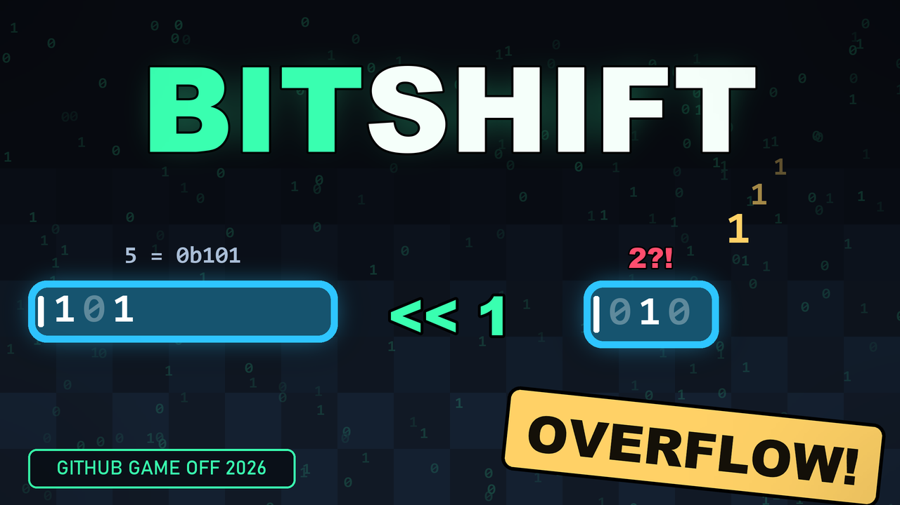
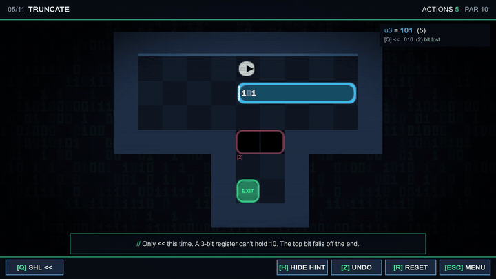

# BITSHIFT

> A programming puzzler about running out of bits.
> Made for **GitHub Game Off 2026**. Theme: **SHIFT**.

## Trailer

[](https://github.com/Agneay-Community-Hub/Bit-SHIFT/releases/download/v1.0.0/BITSHIFT-trailer.mp4)

▶ **[Watch the trailer](https://github.com/Agneay-Community-Hub/Bit-SHIFT/releases/download/v1.0.0/BITSHIFT-trailer.mp4)** (66 s, 1080p)



## Download

| Platform | Download |
|----------|----------|
| Windows (64-bit) | [BITSHIFT-Windows-x64.zip](https://github.com/Agneay-Community-Hub/Bit-SHIFT/releases/latest/download/BITSHIFT-Windows-x64.zip): unzip and run `BITSHIFT.exe` |
| Web build | [BITSHIFT-WebGL.zip](https://github.com/Agneay-Community-Hub/Bit-SHIFT/releases/latest/download/BITSHIFT-WebGL.zip): upload to itch.io or serve locally |

All builds are on the [Releases page](https://github.com/Agneay-Community-Hub/Bit-SHIFT/releases).

## How to play

Every block in the world is a **register**. Its value is its size: a block holding `3` is three tiles long.
Face a block and shift it:

| Key | Instruction | Effect |
|-----|-------------|--------|
| `Q` | `SHL  <<` | value doubles, the block grows |
| `E` | `SHR  >>` | value halves, the block shrinks |
| `F` | `ROL  <<<` | rotate left: the top bit wraps around to the bottom |

Registers are only a few bits wide (`u1` … `u4`, shown by colour and by the digits on the block).
Push one too far and bits fall off the end:

* `0b101 << 1` in a 3‑bit register is `0b010`. The block *shrinks* when you shift it left.
* When a register reaches `0`, it is `free()`d and disappears. Sometimes that's exactly what you need.

Fill every pad (`==n`) with a block of exactly that size to unlock the exit. A block that exactly
covers a pit (`[n]`) drops in and becomes floor. If a block has no room to grow you get a `SEGFAULT`.

## Controls

| | |
|-|-|
| Move / push | `WASD` or arrow keys |
| Shift | `Q` `E` `F` (or click the buttons) |
| Undo / reset | `Z` (hold to rewind) / `R` |
| Toggle hint | `H` |
| Music / SFX | `M` / `N` |
| Menu | `Esc` |
| Unlock all levels (for judges) | `F9` on the level select screen |

Each level has a **par**: the fewest actions possible, computed by a solver. Beat it for an *OPTIMAL* mark.

## How it's built

Everything is generated in code with Unity 6 (`6000.4.3f1`), driven from the command line:
no imported art, sound or fonts.

* `Assets/Scripts/Sim.cs`: the rules, with no rendering.
* `Assets/Scripts/Game.cs`: procedural sprites, animation, input, IMGUI HUD.
* `Assets/Scripts/Sfx.cs`: synthesized sound effects and the chiptune loop.
* `Assets/Resources/levels.txt`: all levels in a plain-text format (legend at the top of the file).
* `Assets/Editor/BuildScript.cs`: CLI entry points (create scene, build, verify).
* `tools/solver.py`: a BFS solver that checks every level is solvable and computes par.

### Build from the command line

```bash
UNITY="C:/Program Files/Unity/Hub/Editor/6000.4.3f1/Editor/Unity.exe"

# 1. solve every level, write par values + reference solutions
python tools/solver.py --write

# 2. replay those solutions through the C# rules (fails if the two disagree)
"$UNITY" -batchmode -nographics -quit -projectPath . -executeMethod BitShift.EditorTools.BuildScript.Verify -logFile -

# 3. build
"$UNITY" -batchmode -nographics -quit -projectPath . -executeMethod BitShift.EditorTools.BuildScript.BuildWebGL -logFile -
"$UNITY" -batchmode -nographics -quit -projectPath . -executeMethod BitShift.EditorTools.BuildScript.BuildWindows -logFile -
```

Output goes to `Builds/WebGL` and `Builds/Windows`. To test the web build locally:
`python -m http.server 8000 --directory Builds/WebGL`.

### Uploading to itch.io

Zip the *contents* of `Builds/WebGL` (so `index.html` is at the root of the zip), upload it as an
HTML game and tick *This file will be played in the browser*. A 1280×720 viewport works well; the
page also scales to any size. The build uses gzip with a decompression fallback, so it needs no
special server headers.

### Adding a level

Add a block to `Assets/Resources/levels.txt`, then run `python tools/solver.py --write` to check it's
solvable and set its par. Big open rooms with many blocks can make the solver slow; tight rooms make
better puzzles anyway.

## License

MIT, see [LICENSE](LICENSE).
